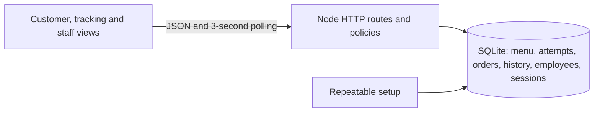
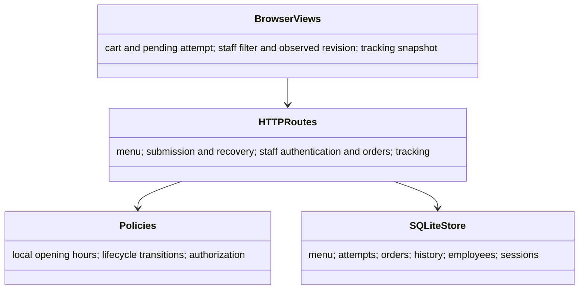

# Implementation

Starting commit: `a196dd9` (the exact independent-build prompt is in `KICKOFF.md`). Node.js 24 and its built-in SQLite provide a local single-process runtime with no external dependencies. Run `npm run setup`, then `npm start`. Setup writes newly generated staff credentials to `data/staff-credentials.txt` (or a timestamped file if it already exists); it does not reset existing accounts or data. Open http://localhost:3000 and use the staff link to sign in.

The database and credentials are local and excluded from Git. Repeated setup uses insert-if-absent semantics. No real restaurant or contact is implied. Public deployment requires an appropriately secured host, TLS, persistent backed-up SQLite storage, protected credentials and an operational review; it has not been deployed.

Milestone: local database and repeatable setup foundation.

## Runtime mapping

The browser code in `public/app.js` implements CustomerView, StaffView, TrackingView, Cart and UpdateCoordinator. `server.js` routes combine the logical controllers with the checkout, access, tracking and order services; its opening and transition checks implement the policies. SQLite tables implement the stores and entities; the order contains JSON snapshots of accepted lines. `setup.js` is SetupRunner. Transactions serialize an attempt's acceptance/rejection and protect status plus history; random 256-bit attempt and tracking tokens provide separate capabilities. Local storage retains a cart and pending attempt. Staff sessions expire after eight hours, and sign-in is limited per IP in process memory. Polling refreshes every three seconds, subject to network and browser scheduling.

Run with Node.js 24 or newer: `npm run setup`, `npm start`, then visit http://localhost:3000. Use `/staff` and the generated local credential file for either `luis` or `elena`. The process binds to loopback, and ordering follows actual Costa Rica time (daily 10:00–21:00); staff can work after closing. The existing local database remains across restarts. To run isolated integration checks, run `npm test`; the test creates and removes a temporary database and tests acceptance only when the restaurant is actually open.

Assumptions: quantities are capped at 999 per line, sign-in sessions last eight hours, and three-second polling is adequate for a local demonstration. The local process and SQLite are not a production deployment architecture. Before hosting, add TLS and secure cookies, configurable binding and proxy policy, durable backups and restore procedures, production credential management and shared rate limiting; validate operational and security requirements. No public deployment was performed.

Milestones: `0d7d09b` setup foundation; `e065afb` customer ordering, tracking and staff workflows; subsequent documentation and verification fixes are recorded in Git history. Draft PR: https://github.com/axantillon/mesa-tica/pull/8.

Playwright follow-up: invalid quantity edits are retained until corrected, closed notices include a dated next opening, and staff filter changes show loading while fetching the selected view. The opening-boundary regression uses an isolated injected clock; production uses real time.
