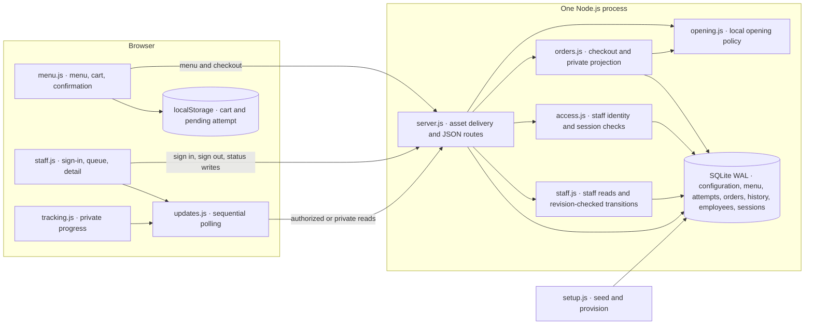
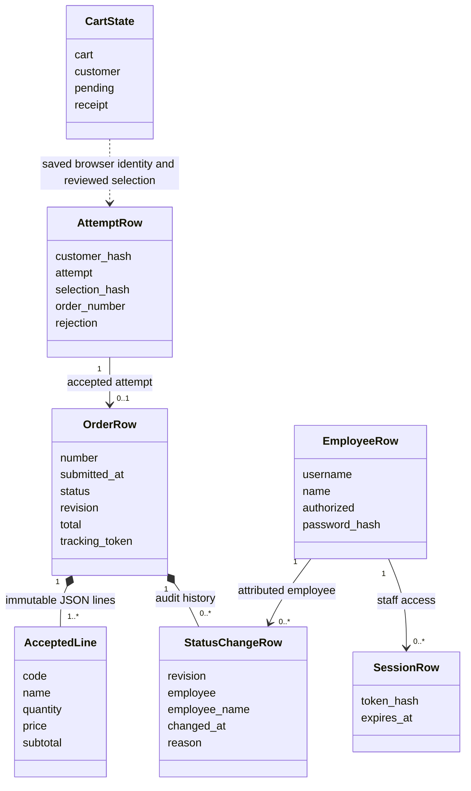

# Mesa Tica implementation

The exact brief is [KICKOFF.md](../KICKOFF.md) at starting commit `3fda43eba3961e2521782e711f154ec90a250a12`. The work is on `implementation/openai`. The specification, restaurant content and logical designs remain in [context](../context/) and [design](../design/).

## Run and sign in

Use Node.js 24 and npm. The application has zero package dependencies at runtime.

```sh
npm run setup
npm start
```

Open http://127.0.0.1:3000 to order. Ordering follows the supplied 10:00 AM–9:00 PM Costa Rica schedule every day. A reviewer outside those hours can browse the menu and exercise order placement with the isolated browser suite below, which supplies an open test clock.

Open http://127.0.0.1:3000/staff to sign in as `luis` or `elena`. Read the corresponding password locally from the generated `data/staff-credentials.json`. To view both staff sessions simultaneously, use a private window or separate browser profile. The passwords are random, hashed with scrypt for authentication, and written for local provisioning in a file with mode 0600. Keep it private. Setup can be repeated and preserves existing configuration, menu edits, passwords, orders and history.

The default bind is `127.0.0.1`, the port is `3000`, and data is kept under `data/`. Set `MESA_DATA_DIR` for another data directory, `PORT` for another port, and `MESA_HOST` for another bind address. Run setup and start with the same data directory.

```sh
npm test
npx --yes --package @playwright/cli@0.1.23 playwright-cli install-browser chromium
npm run test:browser
```

The HTTP and Chromium suites create temporary isolated databases and delete them on completion. Only browser verification downloads tooling. Set `MESA_PLAYWRIGHT_CLI` to an absolute path to an existing Playwright CLI wrapper if needed.

## Runtime architecture



The browser receives server-authoritative JSON. The app serves all pages and assets from the same origin. SQLite is durable across restarts. Browser data is used to recover an attempt before the customer learns its result.

## Logical classes in code



| Supplied responsibility | Implementation |
| --- | --- |
| CustomerView, Cart, CartItem and Confirmation | [menu.js](../public/menu.js) renders menu, reviews local selection, freezes pending checkout and presents accepted details and the tracking link. [common.js](../public/common.js) formats CRC and accepted summaries. |
| StaffView, TrackingView and UpdateCoordinator | [staff.js](../public/staff.js), [tracking.js](../public/tracking.js) and [updates.js](../public/updates.js) render snapshots, retain successful check times and stop superseded reads. |
| MenuController, OrderController, AuthController, StaffOrderController and TrackingController | Method/path branches in [server.js](../src/server.js). Menu composition happens in the menu route. Request parsing lives in [http.js](../src/http.js). |
| CheckoutService, OrderStore and TrackingService | [orders.js](../src/orders.js) validates current menu and hours, closes or accepts the scoped attempt in a transaction, recovers confirmations and projects private reads. [staff.js](../src/staff.js) contains queue and history SQL. |
| OrderService and OrderLifecycle | [staff.js](../src/staff.js) maps permitted transitions, compares revision and writes status and audit history together. |
| AccessService and IdentityStore | [access.js](../src/access.js) verifies scrypt credentials, stores hashed session tokens, authorizes staff requests and revokes sessions. |
| OpeningPolicy, MenuStore and RestaurantStore | [opening.js](../src/opening.js) evaluates the configured schedule. [store.js](../src/store.js) reads SQLite and wraps transactions. |
| SetupRunner and durable entities | [setup.js](../src/setup.js) loads [seed.js](../src/seed.js) into [schema.sql](../src/schema.sql). The restaurant config is a singleton, dishes are positioned menu rows, and employee and order state use dedicated tables. |

## Implementation decisions

- Cart and pending checkout share one local storage record. Web Locks serialize edits and attempt initiation across tabs. Checkout requires JavaScript, working local storage and Web Locks in a secure context (HTTPS or loopback HTTP). Browser state is scoped to that origin. Cart totals display exact integer colones. Accepted totals fit JavaScript's safe integer range.
- A checkout attempt combines a 256-bit browser credential and a separate random attempt ID. A hash records the reviewed selection. Under SQLite `BEGIN IMMEDIATE`, prior outcomes take precedence over current menu and hours. A read without an accepted record remains unresolved. Accepted names, quantities, prices and totals are snapshots.
- Tracking uses a separate 256-bit bearer token. The customer snapshot omits revisions and staff history. Links are shareable to devices that can reach the serving origin. Responses use `no-store` and `no-referrer`. No analytics or external assets are loaded.
- Staff sessions expire after eight hours. The cookie is HttpOnly and SameSite=Strict. Failed logins use a generic response, and sign-in requests are throttled per peer. Cancellation reasons are limited to 500 characters. Staff actions pin the chosen revision, and uncertain writes trigger an authorized read. Polling waits two seconds between reads, with browser scheduling affecting background tabs.
- The fictional contact is shown as supplied. Order numbers are sequential display identifiers padded to four digits. Time displays use Costa Rica local time and the next-opening label includes the weekday and date.

## Deployment handoff

1. Prepare one persistent Node.js 24 host and an HTTPS reverse proxy with a hostname and certificate. Place the checkout on the host with a service account and a private persistent data directory owned by that account (mode 0700).
2. From the checkout directory, run `MESA_DATA_DIR=/srv/mesa-tica/data npm run setup` as that account. Transfer the generated staff passwords privately to the intended operators.
3. Configure a process supervisor to run `MESA_DATA_DIR=/srv/mesa-tica/data MESA_HOST=127.0.0.1 PORT=3000 MESA_SECURE_COOKIES=1 npm start` as the same account. Proxy all paths on the HTTPS origin to `http://127.0.0.1:3000`. Keep the Node listener private. Configure proxy and observability logs to omit private tracking paths, cookie headers and request bodies.
4. Back up the database using a SQLite-consistent backup, and keep credentials separately protected. Test restore on an isolated directory before relying on backups. After bringing up the HTTPS origin, verify Secure session cookies, order placement during restaurant hours, progress and cross-device tracking against that origin.

The intended hosting shape is one application instance with a local SQLite volume. Hosting, TLS, backups and load behavior require verification in the deployment environment.

## Milestones

1. `6d1cbee` Runnable menu foundation, sample data and repeatable setup.
2. `cc22a1a` Cart, checkout and durable recovery, confirmation and private tracking.
3. `a02119e` Staff authorization, filtered queue, detail and audited progress.
4. Browser verification, cart focus and exact totals, consistency measurements and deployment handoff.
