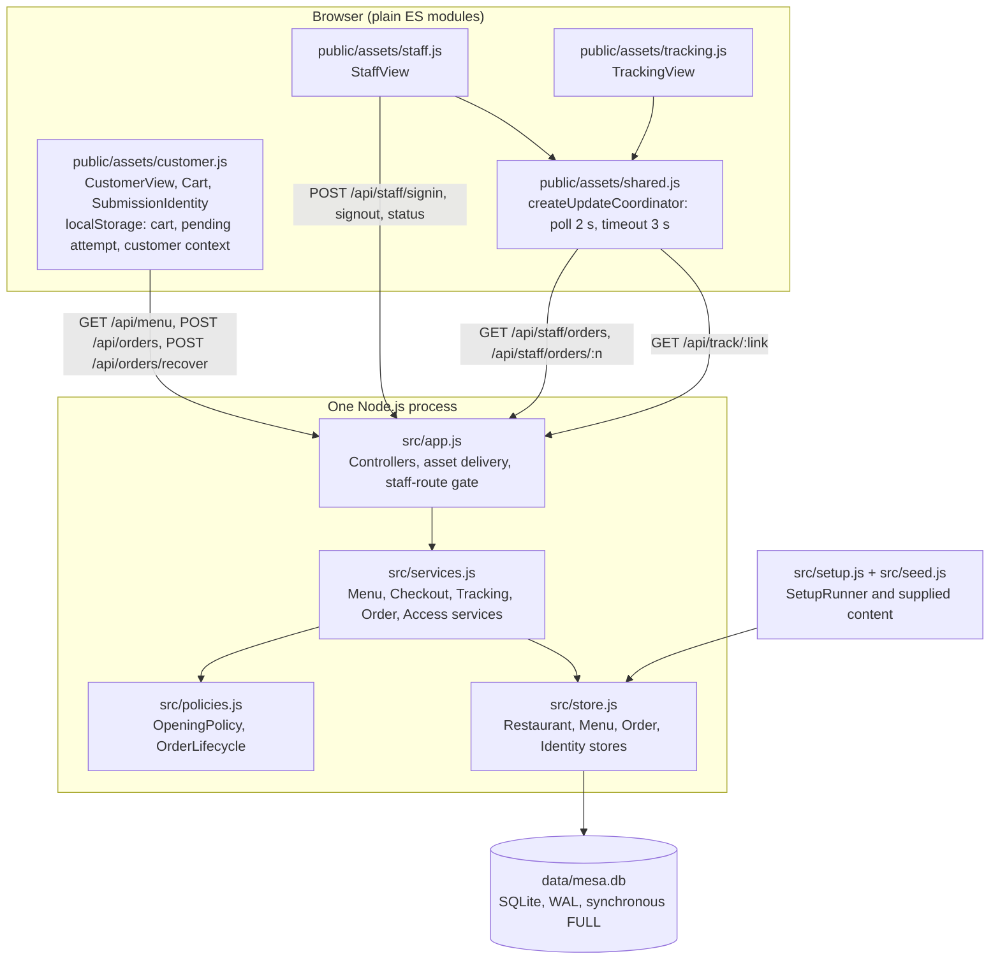
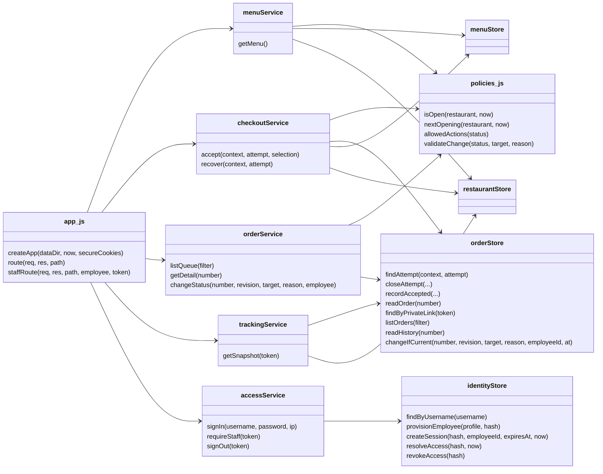

# Implementation record

Built from the kickoff prompt in [`KICKOFF.md`](../KICKOFF.md), kept unchanged in this repository, starting at commit `a196dd944b8605bda3c48486f0d505aa410b7c45` on branch `implementation/round2-anthropic`. Results are in [verification.md](verification.md); remaining work is in [backlog.md](backlog.md).

## Architecture in brief

One Node.js process serves the pages and JSON API and stores everything in one SQLite file. The app has **no runtime dependencies**: `node:http`, `node:sqlite` and `node:crypto` from the standard library, and plain browser JavaScript modules with no build step. Playwright and axe-core are development-only.

I chose this because the app is one restaurant on one machine. SQLite transactions provide the two guarantees that matter most (exactly-once acceptance and one winner per staff conflict), and they also hold across processes. Updates use HTTP polling because it recovers from any outage with no extra code path.

## Run and sign in

Requires Node.js 22.13 or newer. Nothing else is needed to run the app.

```sh
npm start        # runs the repeatable setup, then serves http://127.0.0.1:3000
```

| Page | Address |
|---|---|
| Customer menu | <http://127.0.0.1:3000/> |
| Staff sign-in | <http://127.0.0.1:3000/staff> |
| Order tracking | The private link shown on the confirmation page |

**Staff credentials.** The first setup generates a random password for each of the two accounts, `luis` and `elena`, and writes them to `data/staff-credentials.local.txt`. That file has owner-only permissions and is gitignored; the passwords are never printed. Open the file to sign in. Each line is `username<TAB>password`.

Setup also runs alone with `npm run setup`. Repeating it never duplicates the menu, resets a password or touches orders. Data lives in `data/` and survives restarts. Ordering follows real Costa Rica time, so outside 10:00 AM to 9:00 PM the app correctly refuses new orders.

| Variable | Default | Purpose |
|---|---|---|
| `PORT` | `3000` | Listening port |
| `HOST` | `127.0.0.1` | Bind address; use `0.0.0.0` to test from a phone on your network |
| `MESA_DATA_DIR` | `data` | Database and generated credentials |
| `MESA_SECURE_COOKIES` | unset | Set to `1` when served over HTTPS |

## Test

```sh
npm ci                                   # development dependencies, tests only
npx playwright install chromium          # browser for the end-to-end checks
npm test                                 # API, policy, setup, durability and two-process checks
npm run test:e2e                         # real-browser journeys and accessibility scan
npm run measure                          # quality-target measurements on this machine, about 2 minutes
```

Every test runs the real app on an isolated temporary data directory. Tests control the clock through `createApp({ now })`, which only the test harness passes; production has no time or menu backdoor. To run the customer, staff and tracking journeys on WebKit, run `npx playwright install webkit` and set `E2E_BROWSER=webkit`. The accessibility scan always uses Chromium.

## Deployment (not performed)

No live deployment exists. These steps need an account and host of your choosing:

1. Provision one always-on server with Node.js 22.13+ and a **persistent disk**. Serverless or ephemeral-disk hosts lose the SQLite file.
2. Copy the repository, set `MESA_DATA_DIR` to the persistent disk, set `HOST` and `PORT`, set `MESA_SECURE_COOKIES=1`, and run `npm start` under a process supervisor.
3. Terminate HTTPS at a reverse proxy in front of it. Private links and staff sessions must not travel over plain HTTP.
4. Read the generated credentials from the server's data directory and hand them to staff privately.
5. Before exposing it publicly, address the first items in [backlog.md](backlog.md): request limits on anonymous ordering and backups.

Run one instance. Order and status guarantees hold across processes, but the sign-in limiter is per process.

## How the logical design maps to the code



| Logical element | Actual code | Notes |
|---|---|---|
| CustomerView | `public/assets/customer.js` | Menu, cart and confirmation as hash routes on one page |
| Cart, CartItem | Array of rows in `customer.js`, saved to `localStorage` | `row.price` is the reviewed price |
| SubmissionIdentity (client side) | `pending` in `customer.js` | Saved before sending, so a lost response stays recoverable |
| StaffView | `public/assets/staff.js` | `chosenAction` is the observed revision, fixed for the duration of an action |
| TrackingView | `public/assets/tracking.js` | |
| UpdateCoordinator | `createUpdateCoordinator` in `public/assets/shared.js` | One implementation serves staff and tracking |
| MenuController, OrderController, TrackingController | Route branches in `route()`, `src/app.js` | Framework-native handlers; no wrapper classes |
| AuthController, StaffOrderController | `route()` sign-in branch and `staffRoute()`, `src/app.js` | One gate calls `requireStaff` for every other `/api/staff/` path |
| MenuService, CheckoutService, TrackingService, OrderService, AccessService | Objects returned by `createServices`, `src/services.js` | |
| OpeningPolicy, OrderLifecycle | Functions in `src/policies.js` | Pure, with no I/O |
| RestaurantStore, MenuStore, OrderStore, IdentityStore | Objects returned by `openStores`, `src/store.js` | |
| `findAccepted`, `resolveRejectedAttempt`, `acceptOnce` | One transaction in `checkoutService.accept` | See below |
| `changeIfCurrent` | `orderStore.changeIfCurrent` inside the `orderService.changeStatus` transaction | |
| `issuePrivateLink` | `src/store.js` | 256 random bits, created only with a new order |
| SetupRunner | `runSetup`, `src/setup.js` | |
| Restaurant, MenuItem, Order, OrderedItem, StatusChange, Employee, SubmissionIdentity (server side) | Tables `restaurant`, `menu_items`, `orders`, `order_items`, `status_changes`, `employees`, `attempts` | |
| Confirmation | `buildConfirmation`, `src/services.js` | |
| Money | Whole colones as integers | Formatted only for display |
| Revision | `orders.revision` integer | Never shown to staff |



### How the key guarantees are realized

- **Exactly one order per attempt.** `checkoutService.accept` runs in a single `BEGIN IMMEDIATE` transaction: it returns any recorded outcome for `(context, attempt)` first, otherwise checks hours, prices and availability and writes either one order or one closed attempt. The design's separate acceptance and rejection-resolution steps are one indivisible step here, so a competing acceptance can never be missed. The primary key on `(context, attempt)` backs this up.
- **Uncertain outcomes.** Only an HTTP 200 accepted result or a 422 rejected result is treated as known. Anything else (offline, timeout, 5xx) leaves the attempt pending and the cart locked. The browser saves the attempt before sending it.
- **One winner per staff conflict.** `changeStatus` checks revision then lifecycle inside one transaction, and the `UPDATE` also requires the revision. The status and its history row commit together.
- **Fixed observed revision.** `chosenAction` is captured when the employee chooses and released on dismissal or a known outcome. Background refresh changes the display only.
- **Staff writes are never repeated.** They bypass the coordinator. After an uncertain write, actions stay disabled until the current state has been read.
- **Stale information.** The time of the last check comes only from successful responses, in restaurant time. Failures keep the data and raise the warning; a later success is the only thing that clears it.
- **Accepted contents are immutable.** Names and prices are copied into `order_items` at acceptance, and nothing updates that table.
- **Access.** Staff sessions are 256-bit random tokens, stored hashed, in `HttpOnly; SameSite=Strict` cookies. Passwords use scrypt. An unknown username still costs a full password check. A `Content-Security-Policy` allows same-origin scripts only.

## Decisions and assumptions

| Topic | Decision |
|---|---|
| Maximum quantity | 999 per dish, with its own correction message. The specification sets no limit, but exact totals need one, and a larger number is almost certainly a typing mistake. |
| Price review | Opening the cart compares it with the menu, applies any new price with a visible notice and updates the total. The customer must then press Place pickup order. The button is disabled until that check finishes. Background refresh never alters a cart under review; the server rejects a stale price at submission instead. |
| Cart during an unresolved attempt | Locked, including Add on the menu, so a changed cart can't be submitted as if the earlier attempt failed. |
| Recovering a closed attempt | Check order shows the recorded rejection immediately, so it is not offered as a retry. |
| Cancellation flow | Choosing Cancel order fixes the revision, a form gathers the reason, and a separate dialog gives the final confirmation quoting that reason. |
| Revision fixed at first choice | The revision is fixed from Cancel order through the dialog. If another employee acts while the reason is being typed, the result is an explained conflict and the reason is kept. |
| Reason length | 500 characters. Surrounding whitespace is removed. |
| Sign-in limits | 5 failures per IP and username, or 20 per IP, within 15 minutes. At most 3 password checks run at once. In memory, per process. |
| Session length | 12 hours, durable across restarts. |
| Order numbers | Sequential from 1001. They grant no access. |
| Confirmation page | Kept in `sessionStorage`, so it survives a reload without keeping the private link in long-lived browser storage. |
| Times | All labels are formatted by the server in restaurant time. |
| Updates | Polling every 2 s, with a 3 s timeout, chosen to meet the 5 s freshness target. |
| Dish renames | Only price and availability are compared at acceptance, as the specification states. No screen can rename a dish. |

## Milestones

1. `865c5a3` Runnable foundation: durable storage, repeatable setup, opening rules, menu browsing.
2. `7977374` Customer ordering: cart, exactly-once acceptance, uncertain-outcome recovery, confirmation. The "View progress" link had no page until milestone 3.
3. `7e43d24` Staff and tracking integration: sign-in, queue, revision-bound status changes, private tracking, automatic updates with stale handling.
4. `b762f27` Verification fixes: crash on malformed request paths, cart re-check gating, corrupted browser storage, late write responses, accessibility scan, quality-target measurement.
5. `85ed047`, `4254b24`, `c697d3c` Test-only fixes: WebKit portability, per-test timeouts, measurements that follow browser load order and count failures, and the stale-warning check for Cancelled orders.
6. Final commit on this branch: implementation records, namely this document, verification results, backlog and pull-request description.

GitHub: this branch is pushed to `axantillon/mesa-tica` with draft PR [#9](https://github.com/axantillon/mesa-tica/pull/9). Its description is kept in [pull-request.md](pull-request.md).
