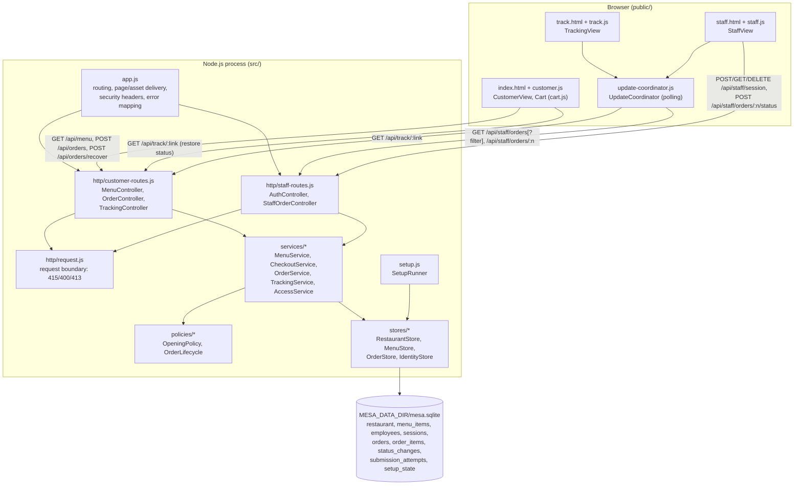
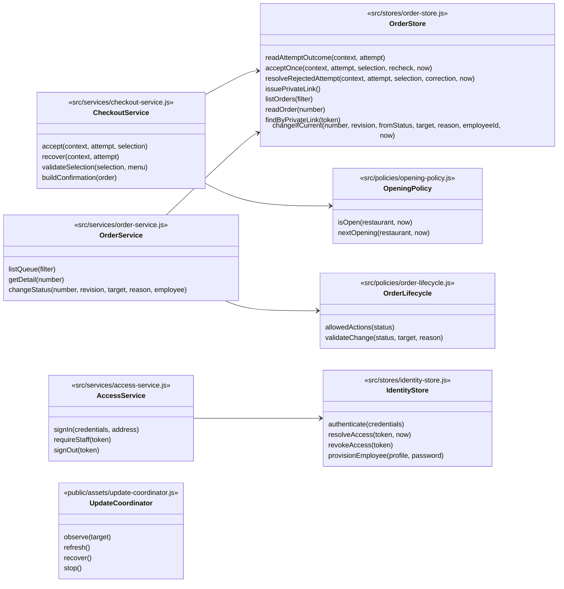

# Mesa Tica implementation

Pickup ordering for the fictional Mesa Tica restaurant: guest menu and cart, reviewed checkout with safe
recovery, confirmation with a private tracking link, live tracking, and a staff queue with conflict-safe status
changes. Verification results are in [verification.md](verification.md); remaining work is in [backlog.md](backlog.md).

## Provenance

- Kickoff prompt: [KICKOFF.md](../KICKOFF.md), unchanged and followed as written.
- Round 3 starting commit: `e18f506f98a21f121ec02ab72001793073e48f1d` ("Merge corrected isolated context for Round 3"),
  the `main` commit containing the complete context revision.
- Implementation branch: `implementation/round3-claude`, started at that commit. `main` is untouched.
- Product and design inputs (`README.md`, `context/`, `design/`) are the sole design authority and were not modified.
- No `origin` remote is configured in this checkout, so nothing was pushed and no draft PR was opened. The
  ready-to-use PR description and the progress notes that would have been PR comments are in
  [pull-request.md](pull-request.md).

## Run it

Prerequisites: Node.js 22.13 or newer (verified on 24.5.0, macOS). The application has **no runtime npm
dependencies**; `npm install` is only needed for the browser test runner.

```sh
npm run setup        # creates ./data/mesa.sqlite, loads restaurant + menu, provisions staff (safe to repeat)
npm start            # http://127.0.0.1:3000/  (staff: http://127.0.0.1:3000/staff)
```

`npm start` also runs the same idempotent setup, so a fresh checkout works with `npm start` alone.
Stop with Ctrl+C (SIGINT/SIGTERM close connections and the database cleanly).

### Signing in as staff

Setup creates two accounts with identical permissions, `luis` (Luis) and `elena` (Elena), with random passwords.
The passwords are written only to `<data dir>/staff-credentials.txt` (mode 0600, git-ignored, never printed):

```sh
cat data/staff-credentials.txt     # username<TAB>password<TAB>(display name)
```

Open `/staff`, sign in with one of those lines. Repeating setup never resets an existing password. If a password is
lost, the operator can run the explicit command `npm run staff:reset-password -- luis`, which sets a new random
password, ends that employee's sessions and appends the new line to the same file (history stays attributed).

### Configuration (environment variables, no source edits)

| Setting | Default | Meaning |
|---|---|---|
| `MESA_HOST` | `127.0.0.1` | Listen address. Use `0.0.0.0` (or a specific interface) for a network-accessible host. |
| `MESA_PORT` | `3000` | Listen port (`0` picks a free port; the chosen URL is printed). |
| `MESA_DATA_DIR` | `./data` | Durable data directory: SQLite file `mesa.sqlite` (+ WAL files) and `staff-credentials.txt`. |
| `MESA_RESTAURANT_FILE` | `config/restaurant.json` | Restaurant details, weekly hours/time zone, menu and staff profiles loaded by setup when absent. |
| `MESA_SECURE_COOKIES` | `false` | `true` adds `Secure` to the staff session cookie. Required when staff use HTTPS. |
| `MESA_SESSION_TTL_MINUTES` | `720` | Staff session lifetime. Expired or revoked sessions require sign-in again. |
| `MESA_REFRESH_INTERVAL_MS` | `3000` | Polling interval for the staff queue/detail and tracking pages. |

Example on a nondefault listener and data location:
`MESA_HOST=0.0.0.0 MESA_PORT=8080 MESA_DATA_DIR=/var/lib/mesa-tica npm start`.

### Deployment notes (account-dependent steps not performed)

No live deployment was made. A network-accessible host needs:

1. Node.js ≥ 22.13 and this repository (`npm ci --omit=dev` is enough; there are no runtime packages).
2. A **persistent, local** filesystem for `MESA_DATA_DIR` (a host disk or a block-storage volume; not NFS/SMB, which
   SQLite locking does not support reliably). Back it up with SQLite's online backup, e.g.
   `sqlite3 /var/lib/mesa-tica/mesa.sqlite ".backup '/backups/mesa-$(date +%F).sqlite'"`.
3. HTTPS termination in front of the app (any reverse proxy or platform load balancer) forwarding to
   `MESA_HOST:MESA_PORT`, with `MESA_SECURE_COOKIES=true` so staff sessions are only sent over HTTPS. Local HTTP stays
   usable with the default `false`.
4. A process supervisor (systemd, a container restart policy or the platform's) running `npm start`.
5. Copy `staff-credentials.txt` to the restaurant's password manager after first start, then delete it from the server.

Several app processes may share one data directory on the same host: acceptance and status changes are serialized
by SQLite write transactions (verified by a two-process test). The sign-in attempt limiter is per process.

## Architecture

One Node.js process serves pages, assets and a JSON API, and stores everything in one SQLite file. Browser pages are
plain HTML + ES modules (no build step). Updates use polling; the logical design leaves transport open.



### Logical design → code

| Logical responsibility | Realized by |
|---|---|
| CustomerView | `public/index.html`, `public/assets/customer.js` (menu, cart rendering, `placeOrder` = reviewAndSubmit/beginAttempt/savePending, `submitPending`, `checkPending` = recoverPending, `acceptKnown` = showConfirmation/retainConfirmation/clearPending, `rejectKnown`, `checkSavedStatus` = restoreConfirmation via the C1 read path, `copyTrackingLink`) |
| Cart, CartItem | `public/assets/cart.js` pure functions (`addItem`, `changeQuantity`, `removeItem`, `calculateTotal`, `applyCorrection`, `clearPurchased`, `reconcileWithMenu`) over `{code, quantity, reviewedName, reviewedPrice}` rows in localStorage |
| TrackingView | `public/track.html`, `public/assets/track.js` |
| StaffView | `public/staff.html`, `public/assets/staff.js` (`signIn`, `renderQueue`, `renderDetail`, `chooseAction`/`openCancelConfirmation`/`submitChange` = requestChange, `showConflict` branch for 409, `handleAccessLost`, `signOut`; draft reason in sessionStorage) |
| UpdateCoordinator | `public/assets/update-coordinator.js` (`observe`, `refresh`, `recover`, `stop`, `state.lastSuccessfulCheck/currentInformation/stale`) |
| MenuController, OrderController, TrackingController | route handlers in `src/http/customer-routes.js` |
| AuthController, StaffOrderController | route handlers in `src/http/staff-routes.js` |
| Request boundaries | `src/http/request.js` (`readJson`, validators) used by every body route; filter/number/target validation in the controllers |
| MenuService, CheckoutService, OrderService, TrackingService, AccessService | `src/services/*.js` factory functions |
| OpeningPolicy, OrderLifecycle | `src/policies/opening-policy.js`, `src/policies/order-lifecycle.js` |
| RestaurantStore, MenuStore, OrderStore, IdentityStore | `src/stores/*.js` over `node:sqlite` |
| SetupRunner | `src/setup.js` (`runSetup`, also invoked by `npm start`) |
| Restaurant, MenuItem, Employee | `restaurant.details` JSON row, `menu_items`, `employees` tables; loaded from `config/restaurant.json` |
| Order, OrderedItem, StatusChange | `orders`, `order_items`, `status_changes` tables |
| SubmissionIdentity | browser: pending attempt `{attempt, selection, lines, total}` + customer context in localStorage; server: `submission_attempts` keyed by `(customer_context, attempt_id)` with outcome `accepted`/`closed`, selection and correction |
| Confirmation | `CheckoutService.buildConfirmation` JSON, saved by the browser in sessionStorage |
| Money | integer colones end to end; formatted `₡7,900` |
| Revision | `orders.revision` integer, incremented on each status change; hidden in the UI |
| PrivateLink | `orders.private_token`: 24 random bytes (192 bits) base64url; URL `/track/<token>` |



### Combined logical operations and where their guarantees live

- **findAccepted / readAttemptOutcome.** One store read returns `accepted` (with the order), `closed` (with the
  original correction) or `absent`. `findAccepted` is its accepted branch; no separate function exists.
- **acceptOnce.** `CheckoutService.accept` first returns any recorded decision for the attempt (so an accepted retry
  succeeds after closing or a menu change and a closed attempt stays closed), then performs early checks for useful
  corrections. `OrderStore.acceptOnce` then opens one `BEGIN IMMEDIATE` transaction in which it re-reads the attempt
  outcome, calls the service's `recheck` (current menu, prices and opening hours at the same instant) and either inserts
  the order, its lines, the private link and the accepted attempt row together, or records the attempt as closed. The
  write lock is held from the first read, so the check and the write are indivisible even across processes;
  `(customer_context, attempt_id)` is the primary key and `order_number` is unique per attempt as a backstop.
- **resolveRejectedAttempt.** The early-rejection path also runs in a write transaction that first re-reads the
  attempt; a competing acceptance is returned instead of a rejection. Request-validation errors (400/415) are raised
  before any of this and record nothing.
- **changeIfCurrent.** `OrderService.changeStatus` reads the order (missing → 404, other revision → 409) and asks
  `OrderLifecycle.validateChange` (invalid transition or blank reason → 422). The store then runs
  `UPDATE orders … WHERE number = ? AND revision = ? AND status = ?` and, only if exactly one row changed, inserts the
  `status_changes` row (employee, time, reason) in the same transaction. The from-status condition re-checks the
  validated transition at the write boundary; a lost race returns the current order as a conflict.
- **Server authority.** Prices, totals, availability, opening decisions, permitted actions and all customer guidance
  text (status meaning, correction and closed messages) come from the server. The browser never sends totals.
- **Staff access.** Every staff route calls `AccessService.requireStaff` (session token → current authorized employee)
  before reading or writing; tracking tokens are not sessions and grant no staff access.

## Key decisions and assumptions

- **Stack:** Node.js standard library (`node:http`, `node:sqlite`, `crypto.scrypt`) and vanilla browser modules, to
  keep the runtime dependency-free and runnable offline. `node:sqlite` still prints an ExperimentalWarning on Node 24;
  npm scripts suppress it.
- **Update transport:** polling every 3 s (configurable), 8 s refresh timeout. Responses older than the latest applied
  one, or for a previous target, are ignored; detail snapshots with a lower revision than the one shown are ignored.
- **Order numbers** are sequential from 101; they identify pickup and grant no online access.
- **Quantities:** whole numbers 1–99 per dish (99 is an assumption to keep totals exact and plausible; above it the UI
  says "Enter a whole number from 1 to 99."), at most 50 lines per order.
- **Price review:** when the menu changes while a cart is open, submission is rejected with the new price and total;
  when the page is reopened, the cart shows the new price with the same notice. Either way the customer must press
  "Place pickup order" again; the server accepts only when every reviewed price equals the current price.
- **Customer context:** a random identifier per browser (localStorage) scopes attempt recovery, so another customer
  cannot recover or reveal someone else's attempt even with the same attempt identifier.
- **Same-tab confirmation:** confirmation lives in sessionStorage; the cart, pending attempt and customer context in
  localStorage. The confirmation is stored before the pending attempt is deleted; if storage fails the pending attempt
  is kept for recovery and the page says "Save this tracking link before leaving this page."
- **Recent order banner:** after "Start a new order" the menu shows a link back to the saved confirmation in this tab.
- **Times:** all dates/times are rendered in America/Costa_Rica and always include the date. "Last checked/refresh"
  times are the browser's time of the successful response, shown in the restaurant zone.
- **Next opening** labels always include weekday and date, e.g. "Opens Wednesday, November 11 at 10:00 AM (Costa Rica time)".
- **Payment statement** ("Pay at collection. There is no online payment.") is shown for Received/Preparing/Ready and
  omitted for Collected/Cancelled; only Ready shows pickup instructions and invites collection.
- **Cancellation reasons** are trimmed, required, ≤ 300 characters; shown verbatim to the customer.
- **Staff sessions:** random 256-bit token in an `HttpOnly; SameSite=Strict` cookie (`Secure` when configured), stored
  as a SHA-256 hash with expiry; sign-out deletes it. JSON-only bodies plus SameSite=Strict protect against CSRF.
- **Sign-in limiting:** after 5 failures for a username (or 30 from one address) within 10 minutes, sign-in returns
  HTTP 429 "Too many sign-in attempts. Wait a few minutes, then try again." Unknown usernames are hashed against a dummy
  password so timing and responses do not reveal account existence.
- **Setup:** the menu is loaded once (tracked by a `setup_state` marker), so an operator-emptied or edited menu is not
  refilled; the restaurant row is inserted only if missing; employees only if the username is new.
- **Errors:** unexpected failures return a generic 503 without traces; private tracking URLs are never logged.
- **Non-JSON interfaces:** HTML pages and assets are GET-only and take no body; other methods on page paths return 404
  and nothing is processed. All writes go through the JSON API.
- **Test clock isolation:** `src/server.js` always uses the system clock. The adjustable clock and direct database
  helpers exist only in `test/support/harness.js`, which builds the same app handler in-process for tests.

## Tests

```sh
npm install                      # once: installs @playwright/test 1.63.0 (dev only)
npx playwright install chromium  # once, if Chromium revision 1243 is not already cached
npm test                         # node:test unit + API checks (59)
npm run test:browser             # Playwright browser journeys (37), phone + desktop Chromium
npm run test:all                 # both
```

Every API test file and every browser test starts its own app on a fresh temporary data directory with generated
staff credentials and a test clock set to an open time (Tuesday 2026-11-10 12:00 Costa Rica). Tests change time,
menu prices/availability, weekly hours and sessions only through that harness.

## Milestones

| Commit | Milestone |
|---|---|
| `cf12e0a` | Runnable backend foundation: stores, policies, services, controllers, setup, server entry. |
| `b5641cd` | Customer, tracking and staff views; unit and API checks (browser UI not yet verified at that commit). |
| `f13931b` | Playwright browser suite (37 journeys) and small staff layout fixes. |
| (this commit) | Implementation, verification and backlog documentation; local PR description. |
