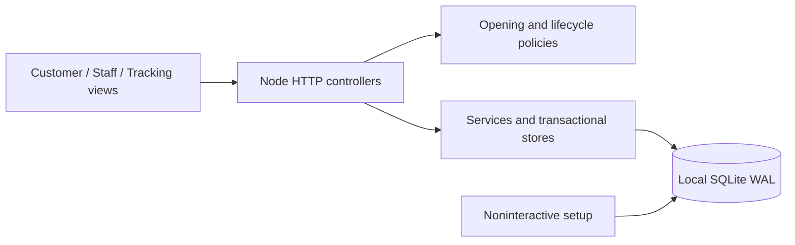
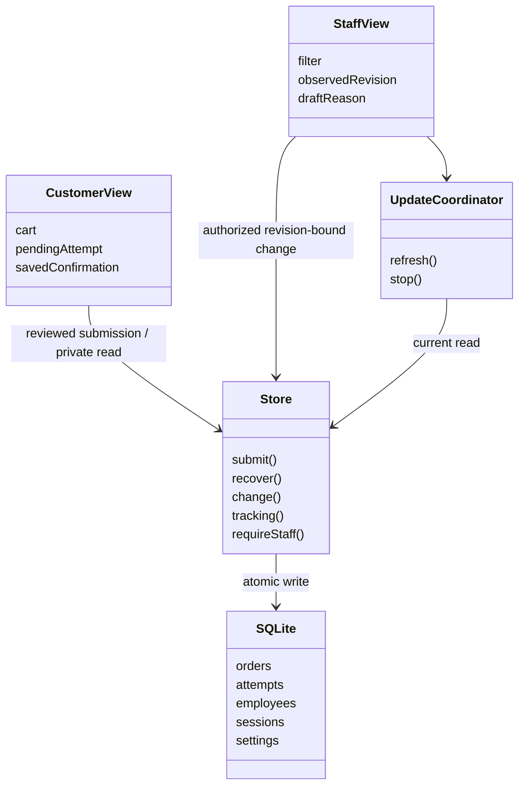

# Mesa Tica implementation

Starting context: `e18f506f98a21f121ec02ab72001793073e48f1d`, on the supplied `implementation/round3-openai` branch. The exact kickoff remains unchanged at [KICKOFF.md](../KICKOFF.md). Product context and canonical diagrams remain unchanged; no earlier application or implementation branch was used.

## Setup and run

Requires Node.js 24 or newer, including built-in SQLite. Runtime has no third-party dependencies.

```sh
npm run setup
npm start
```

Open http://127.0.0.1:3000 and http://127.0.0.1:3000/staff. Setup generates two distinguishable accounts (`luis`, `elena`) and writes local credentials to ignored `var/staff-credentials.txt`, mode 0600. Read this file locally to sign in. Repeating setup preserves passwords, configuration and orders. Optional `STAFF_LUIS_PASSWORD` and `STAFF_ELENA_PASSWORD` (at least 12 characters) provision new accounts noninteractively; never store these values in Git. Passwords use salted scrypt. Sign-in checks use asynchronous derivation, bounded concurrency and per-address throttling.

Read the generated sign-in details with `cat var/staff-credentials.txt`. Add dishes, review the cart and choose Place pickup order while open; save the private link. In another tab/browser, sign in as staff, open the order and use Mark Preparing → Mark Ready → Mark Collected. Tracking updates automatically. Received/Preparing/Ready can instead be cancelled with a reason and final confirmation. Payments happen outside the app.

## Rerunnable verification

Runtime needs only Node 24+. Browser tests additionally need the lockfile's development dependencies (Playwright and axe), downloaded Chromium and host browser libraries. On Linux provision Playwright's documented OS dependencies with `npx playwright install-deps chromium` (may require administrator access).

```sh
npm ci
npx playwright install --no-shell chromium
npm run check
npm test
npm run test:browser
```

The config selects new headless Chromium (`channel: chromium`), so a separate headless-shell download is unnecessary. If normal caches are unwritable, use a writable location consistently:

```sh
npm ci --cache /tmp/mesa-npm-cache
PLAYWRIGHT_BROWSERS_PATH=/tmp/mesa-browsers npx playwright install --no-shell chromium
PLAYWRIGHT_BROWSERS_PATH=/tmp/mesa-browsers npm run test:browser
```

Every test creates a temporary database with randomly generated test passwords. Tests never reset `var/` data. `tests/fixture.mjs` injects a clock through the application factory; normal start has no test-clock environment variable or route. Fixture settings cover repricing, availability and empty schedules. Browser traffic uses real HTTP endpoints/database operations. Interception drops requests or drops responses after the real server commits a write.

Screenshots go to `/tmp/mesa-evidence`, overridable with `MESA_SCREENSHOT_DIR`; they may contain private test links and stay outside Git. Traces and automatic screenshots are disabled. Ignored Playwright failure contexts may contain test-only order data; review before sharing. Browser plugin was absent, so regular Playwright was used. Chromium aborted inside the desktop filesystem sandbox; the approved outside-sandbox run worked.

`HOST` defaults to `127.0.0.1`, `PORT` to `3000`, `DATA_PATH` to `var/mesa.sqlite`. Use the same `DATA_PATH` for setup and start. `SECURE_COOKIES=true` enables Secure staff cookies for HTTPS operation. Normal operation always uses real time and configured restaurant-local hours. No test-clock environment variable or test route exists.

## Architecture and logical mapping

`src/server.mjs` implements page delivery and all logical controllers: validates representation, enforces same-origin writes, authorizes staff requests, and dispatches services. `src/store.mjs` combines CheckoutService/OrderService/TrackingService/AccessService with their SQLite persistence handlers. `src/policies.mjs` implements OpeningPolicy, OrderLifecycle and collectionGuidance; loaded settings realize MenuStore and RestaurantStore. `src/setup.mjs` is SetupRunner and provisions IdentityStore without resets. Combining operations avoids empty wrappers while placing checks inside the final transaction.

SQLite `BEGIN IMMEDIATE` covers prior-attempt lookup, current validation, order creation and outcome recording. Rejected outcomes are durable too. Private customer context and attempt identities are independent 256-bit browser-generated secrets; scoped lookup requires both. Tracking links use 256 random bits; public projection excludes private keys and staff history. Immutable accepted items are persisted with each order. Status and attributed history are saved in one revision-checked transaction. SQLite serializes concurrent writers across connections/processes.

Browser views use semantic HTML and small ES modules. `shared.js` owns UpdateCoordinator, formatting and request timeout handling. Customer state is one localStorage record, enabling known acceptance/private link and purchased-cart clearing in a single write before pending information is discarded. Staff cancellation drafts use sessionStorage keyed by order. No protected detail is stored in browser storage.

`public/app.js` realizes CustomerView, Cart and TrackingView; `public/staff.js` realizes StaffView. Observers allow one read in flight, invalidate late responses, preserve last successful snapshots/times and clear warnings only after current successful reads. Staff reads stop during writes. Cancellation freezes the observed revision when the dialog opens, even while detail refreshes. Closing-time updates change notices/submit eligibility without replacing active inputs. Storage failure retains the visible private link/manual-save route; an unresolved attempt blocks a different submission.





## Decisions and deployment

Framework-free Node HTTP + browser ES modules keep local setup small. Integer CRC values avoid floating-point money. Quantities are bounded to 999 per dish; reasons to 1000 characters, bodies to 32 KiB. Polling every two seconds with a seven-second request timeout provides live updates without infrastructure. A missing outcome remains uncertain until checked or safely retried. No automatic write retry is used.

Use a persistent local filesystem for SQLite, including its WAL/SHM files; do not place it on an ephemeral/serverless disk or a network filesystem. Back up with SQLite's online backup mechanism or stop the app before copying its database. The local repository happens to be in an iCloud folder; production data should use a local persistent volume outside synchronization. For hosting, install Node 24+, run setup on the persistent volume, bind behind a reverse proxy, configure `HOST`, `PORT`, absolute `DATA_PATH`, and `SECURE_COOKIES=true`, terminate HTTPS at the proxy, preserve Host, and redirect HTTP to HTTPS. Do not expose the SQLite file or credential file through the web server. Restrict filesystem access to the application operator. HTTPS, deployment and load targets require separate verification; nothing is deployed by this build.

Example (choose an existing writable persistent directory):

```sh
DATA_PATH=/absolute/persistent/mesa.sqlite npm run setup
HOST=127.0.0.1 PORT=8080 DATA_PATH=/absolute/persistent/mesa.sqlite SECURE_COOKIES=true npm start
```

For direct local HTTP leave `SECURE_COOKIES` unset. For HTTPS forward the public Host unchanged; origin validation expects HTTPS when Secure cookies are enabled. Staff sessions expire after eight hours. The host must protect the process/files and avoid caching `/api/`. Provisioned employees have identical permissions; no public registration/reset UI exists.

Current official Apple HIG [accessibility](https://developer.apple.com/design/human-interface-guidelines/accessibility), [typography](https://developer.apple.com/design/human-interface-guidelines/typography) and [alerts](https://developer.apple.com/design/human-interface-guidelines/alerts) consulted for clear text, target size, color-independent status, reflow and explicit destructive confirmation. Translated into browser conventions; no glass effects or animation. Supplied product documents remain the product-design authority.

“Keep order” deliberately distinguishes dismissing the cancellation dialog from cancelling the order, instead of the HIG's generic “Cancel” label. Escape, focus containment and focus restoration are provided. Body text is 17px with relative sizing; buttons/navigation targets are at least 44px. The green/neutral palette, serif display heading and text-led menu require no external assets. No HIG-compliance certification is claimed.

## Milestones

1. Foundation: persistent schema, safe setup, policies, transactional services, guarded HTTP controllers and accessible page shell. `npm run setup` succeeds; server syntax passes. Customer/staff behavior and full verification still in progress.
2. Customer ordering: menu/cart, exact totals and quantity corrections, durable attempt recovery, confirmation restoration and private tracking UI. Syntax checks pass. Browser verification remains in progress. Draft PR: https://github.com/axantillon/mesa-tica/pull/10.
3. Staff integration: authenticated queue/detail, automatic updates, stale states, revision-bound cancellation dialog, attributed history and same-order cancellation draft recovery. `npm test`: 9 tests passed, including 100 submission cases and 100 conflict pairs; `npm run check` passed. Browser suite is being added, so rendered outcomes are not yet claimed. Dev-only Playwright/axe dependencies installed using a temporary npm cache because the default cache was not writable.
4. Verification fixes: browser checks found and fixed an unavailable-button accessible-name mismatch, modal Tab cycling, enlarged-text dish layout and undersized navigation target. Review tightened navigation response ordering, authorization immediately before writes, terminal confirmation headings and closing-time focus retention. `verification.md` retains original failures and follow-up outcomes.

Final verification: `npm test` 11/11 passed (2.55s), browser suite 15/15 passed (49.0s), syntax/whitespace checks passed. Normal `npm start` served localhost with 9 supplied dishes; desktop/mobile runtime smoke had no console errors or horizontal overflow. Final source/docs are committed locally. Automatic review blocked the final GitHub progress comment, so final publication is pending explicit approval; `docs/pr-description.md` preserves the prepared PR update/comment. Earlier foundation/customer/staff milestones were pushed successfully.
